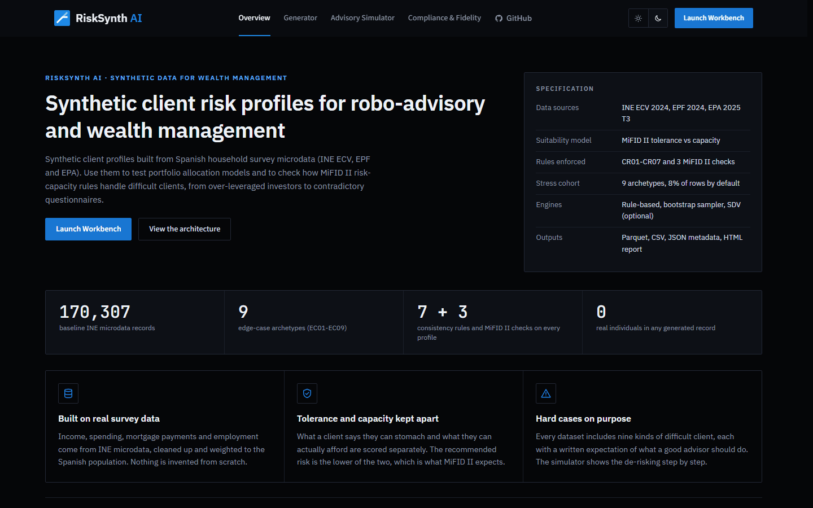
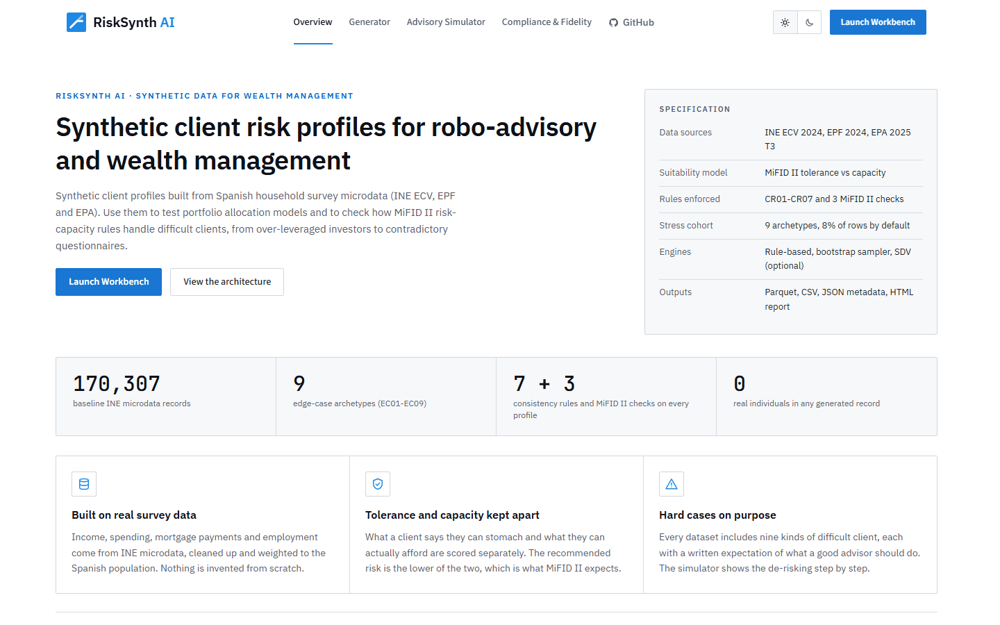
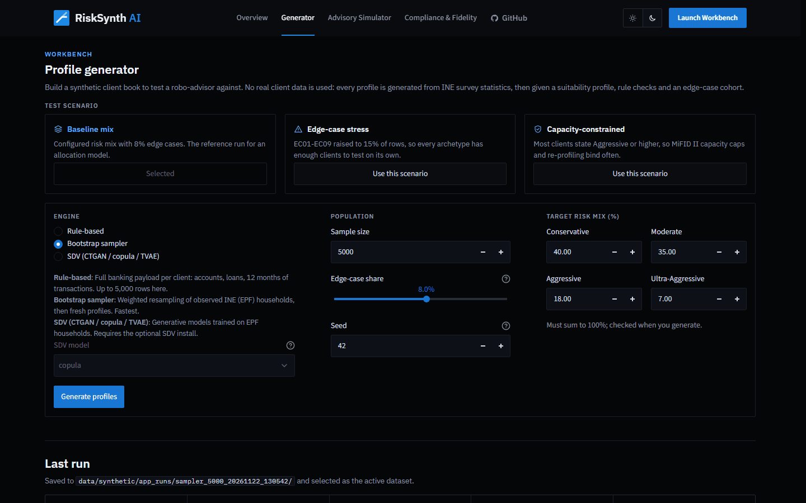
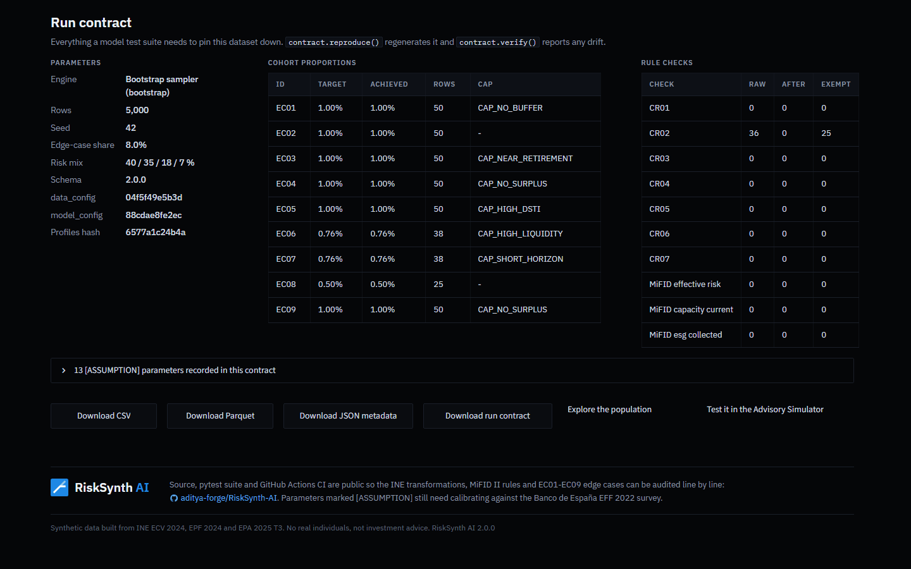
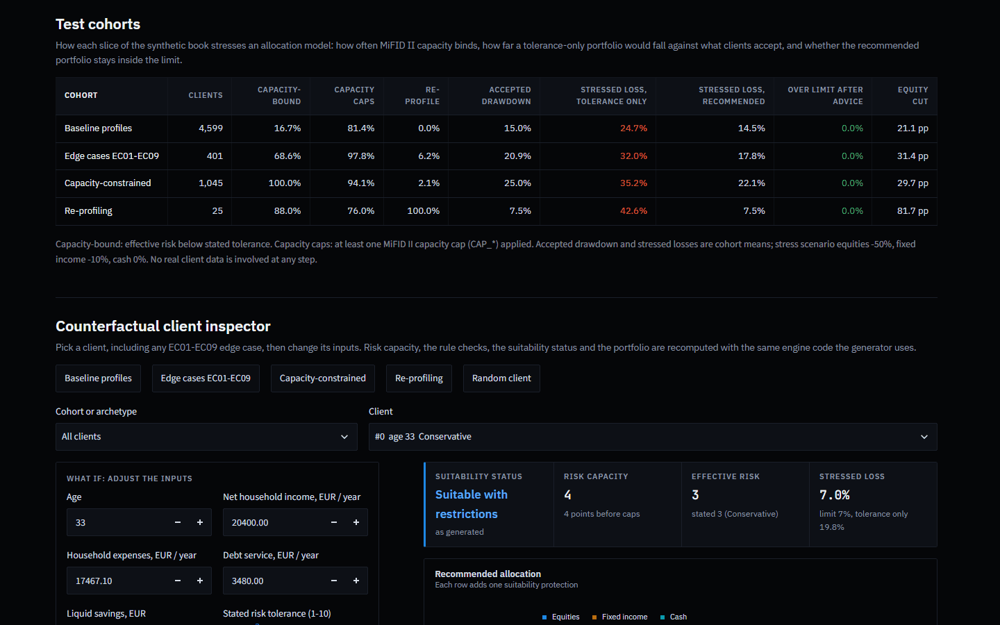
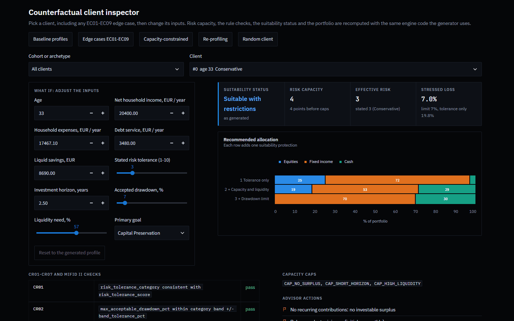
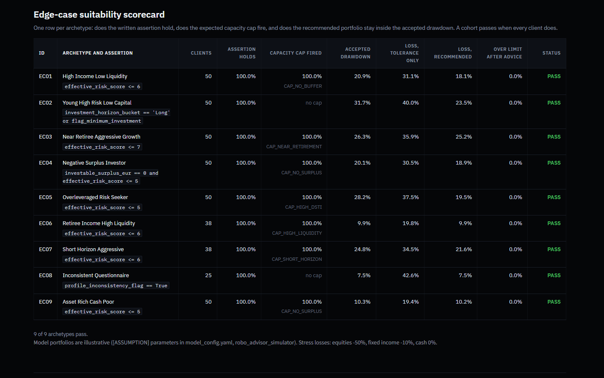
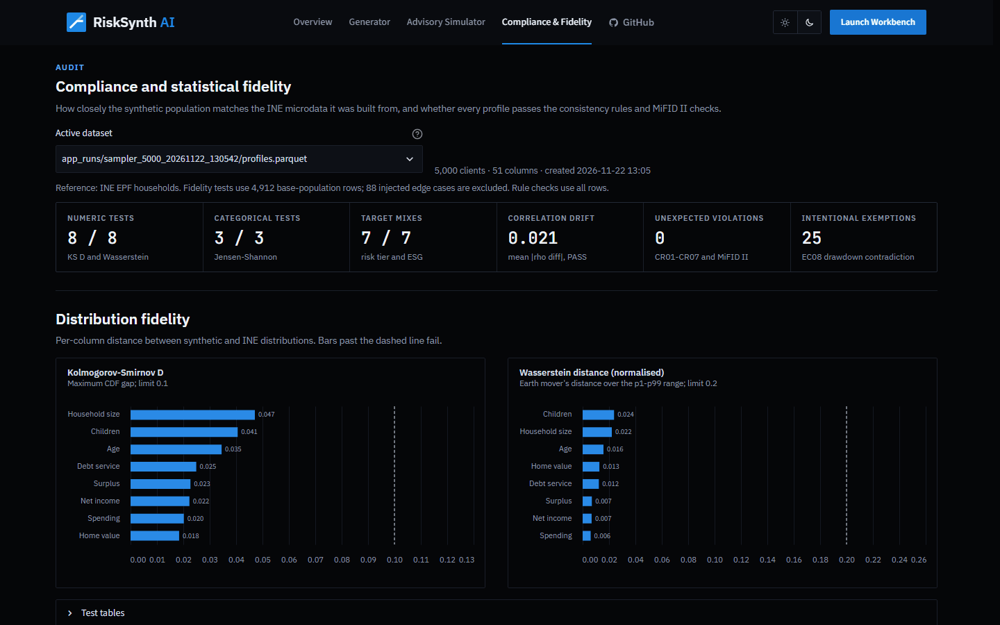
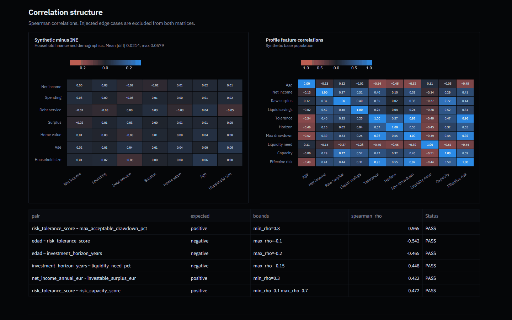

<h1>&nbsp;RiskSynth AI</h1>

Synthetic client risk profiles for testing robo-advisors and MiFID II suitability engines, built from Spanish INE household survey microdata.

- **Live workbench:** https://risksynth.streamlit.app/
- **Repository:** https://github.com/aditya-forge/RiskSynth-AI
- **Study guide:** [Learn_Guide.md](Learn_Guide.md), covering foundations, the maths, a module walkthrough, and viva and interview questions

Synthetic data for development and testing. It is not calibrated to any real client book and it is not investment advice. Read [Calibration status](#calibration-status) before treating any distribution as a statistic about Spanish households.

## Contents

- [The problem](#the-problem)
- [What a generated profile contains](#what-a-generated-profile-contains)
- [How a profile is built](#how-a-profile-is-built)
- [Suitability model](#suitability-model)
- [Consistency rules CR01-CR07](#consistency-rules-cr01-cr07)
- [Edge-case cohort EC01-EC09](#edge-case-cohort-ec01-ec09)
- [The workbench](#the-workbench)
- [Local setup](#local-setup)
- [Command line and Python](#command-line-and-python)
- [Evaluation](#evaluation)
- [Calibration status](#calibration-status)
- [Deployment and CI](#deployment-and-ci)
- [Tests](#tests)
- [Project layout](#project-layout)
- [Why the code is public](#why-the-code-is-public)
- [Data sources and license](#data-sources-and-license)

## The problem

A robo-advisor maps a client's answers and finances to a portfolio. Before it goes live, the mapping has to be tested across many kinds of clients, including rare and awkward ones: the high earner with no savings, the near-retiree chasing growth, the client whose questionnaire answers contradict each other. Real client files cannot be used freely for this because of privacy and data-protection rules, and the rare cases are too thin in any real book to test properly.

RiskSynth AI generates client profiles that:

- follow the demographic and household-finance patterns of Spanish INE survey microdata (ECV, EPF and EPA);
- carry the suitability fields a MiFID II assessment needs, with stated risk tolerance and objective risk capacity kept separate;
- pass seven consistency rules (CR01-CR07), with an audit trail of what was repaired;
- include a tagged stress cohort of nine edge-case archetypes (EC01-EC09), each with a written, testable expectation of what a correct advisor should do.

No record corresponds to a real person.

## What a generated profile contains

| Group | Main columns |
|---|---|
| Demographics (INE) | `edad`, `sexo`, `ccaa` (NUTS2), `nivel_estudios`, `situacion_laboral`, `n_miembros`, `dependent_children` |
| Household finances (EPF) | `net_income_annual_eur`, `household_expenses_annual_eur`, `debt_service_annual_eur`, `main_residence_value_eur`, `household_finance_source` (`observed` or `donor_epf`) |
| Surplus and leverage | `raw_surplus_eur` (signed), `investable_surplus_eur` (floored at 0), `surplus_ratio`, `debt_service_to_income`, `liquid_savings_eur` |
| Suitability | `risk_tolerance_score` (1-10) and `risk_tolerance_category`, `investment_horizon_years` and `investment_horizon_bucket`, `max_acceptable_drawdown_pct`, `liquidity_need_pct`, `esg_preference_level`, `primary_investment_goal` |
| Risk capacity | `risk_capacity_points`, `risk_capacity_score`, `capacity_caps_applied`, `effective_risk_score`, `flag_minimum_investment` |
| Audit | `cr_violations_raw`, `cr_repaired`, `profile_inconsistency_flag` |
| Edge cases | `edge_case_id`, `edge_case_matches`, `edge_case_origin`, `is_edge_case`, `expected_robo_behavior`, `edge_case_assertion`, `edge_case_assertion_pass` |
| Rule-based engine only | accounts, balances, mortgage and personal loans, 12 months of transactions, `prob_default`, `default` |

Tolerance categories: 1-3 Conservative, 4-6 Moderate, 7-8 Aggressive, 9-10 Ultra-Aggressive. Horizon buckets: Short under 3 years, Medium 3 to under 7, Long 7 or more.

## How a profile is built

| Stage | Module | What happens | Output |
|---|---|---|---|
| Ingestion | `risksynth.ingest.ine` | Maps ECV 2024, EPF 2024 and EPA 2025 T3 to one schema. Fixes include age from year of birth, `-9` missing codes, EPF spending divided by the survey weight `FACTOR`, and harmonised sex, region, education and employment codes. | `data/processed/*.parquet` (committed) |
| Stage 1 | `risksynth.generators` | Base households from one of three engines: rule-based (full banking payload), bootstrap sampler (weighted resampling of EPF households), or SDV (CTGAN, Gaussian copula, TVAE). | Base rows |
| Input resolution | `engine.wealth_profile.resolve_inputs` | Rows without household finances (ECV, EPA persons) take the block of a weighted EPF household from the same age band and employment group (hot-deck). | One coherent finance block per row |
| Stage 2 | `engine.wealth_profile`, `engine.consistency` | Derives surplus, goal, horizon, tolerance, drawdown, liquidity need, ESG preference and risk capacity. Then validates CR01-CR07 and the MiFID II checks, and repairs them in a fixed order. | Suitability profile and audit columns |
| Stage 3 | `engine.edge_cases` | Fills a quota per EC01-EC09 archetype, natural matches first. Any shortfall is injected by changing as few fields as possible, then the rules are re-checked. | Tagged stress cohort, 8% by default |
| Testing tools | `risksynth.scoring`, `risksynth.evaluation`, `risksynth.contract` | Model-portfolio simulator, counterfactual re-scoring, EC01-EC09 scorecard, fidelity and compliance report, run contracts. | Reports and the workbench |

Stages 2 and 3 are shared by every engine (`risksynth.engine.stage2.run_stage2`), so all outputs have the same schema and rules. Every parameter lives in `configs/data_config.yaml` (INE mapping, feature specs, capacity points and caps, rules, edge cases) or `configs/model_config.yaml` (stage-1 models, statistical targets, evaluation thresholds, simulator parameters).

## Suitability model

MiFID II separates what a client is willing to lose from what they can afford to lose. RiskSynth keeps the two apart and lets the lower one decide.

- `risk_tolerance_score` (1-10) is the stated, psychometric willingness to take risk. It comes from a latent linear model of age, income, surplus ratio, education, employment, children, goal and horizon plus noise, rank-mapped to a 40/35/18/7% target mix.
- `risk_capacity_score` (1-10) is the objective ability to bear losses: additive points, then hard caps.
- `effective_risk_score = min(risk_tolerance_score, risk_capacity_score)`, which is what an allocation should use.

Capacity points (maximum 10):

| Input | Points |
|---|---|
| `surplus_ratio` | below 0: 0, 0 to 0.10: 1, 0.10 to 0.25: 2, 0.25 or more: 3 |
| `investment_horizon_bucket` | Short 0, Medium 1, Long 2 |
| `debt_service_to_income` (DSTI) | 0.35 or more: 0, 0.20 to 0.35: 1, below 0.20: 2 |
| Employment stability | unemployed or inactive 0, temporary or retired 1, permanent 2 |
| `liquidity_need_pct` | 50 or more: 0, below 50: 1 |

Caps, applied after the points (the lowest applicable cap wins):

| Cap | Condition | Max capacity |
|---|---|---|
| `CAP_NO_SURPLUS` | `investable_surplus_eur == 0` | 5 |
| `CAP_HIGH_DSTI` | `debt_service_to_income >= 0.35` | 5 |
| `CAP_NO_BUFFER` | liquid savings below 3 months of expenses | 6 |
| `CAP_SHORT_HORIZON` | horizon bucket Short | 6 |
| `CAP_HIGH_LIQUIDITY` | `liquidity_need_pct >= 50` | 6 |
| `CAP_NEAR_RETIREMENT` | `edad >= 55` and horizon under 10 years | 7 |

`flag_minimum_investment` marks clients below the product minimums (EUR 1,000 initial or EUR 50 a month, both `[ASSUMPTION]`).

## Consistency rules CR01-CR07

| Rule | Definition | Repair |
|---|---|---|
| CR01 | `risk_tolerance_category` consistent with `risk_tolerance_score` | recompute the category |
| CR02 | `max_acceptable_drawdown_pct` within the category band (5-10, 10-20, 20-30, 30-40%) +/- 2 pp | clip into the band |
| CR03 | `investment_horizon_bucket` consistent with `investment_horizon_years` | recompute the bucket |
| CR04 | goal is not Retirement once `edad >= 67` | resample the goal without Retirement, redraw the horizon |
| CR05 | horizon no longer than `90 - edad` | cap the horizon (floor 0.5 years) |
| CR06 | `investable_surplus_eur == max(0, raw_surplus_eur)` | recompute |
| CR07 | Capital Preservation goal implies a horizon of 5 years or less | cap the horizon at 5 |

Repairs run in the order CR06, CR04, CR07, CR05, CR03, CR01, CR02. Risk capacity and effective risk are then recomputed. Three MiFID II checks run alongside the rules: effective risk equals the minimum of tolerance and capacity, capacity matches a fresh computation, and the ESG preference is recorded. `cr_violations_raw` keeps what the raw draw broke and `cr_repaired` what was fixed, so a repaired profile can still be traced back to its draw.

## Edge-case cohort EC01-EC09

Every row is checked against every scenario (`edge_case_matches`). Separately, a fixed-size test cohort (`edge_case_id`) gets `round(target_share x N)` rows per scenario, 8% in total. Natural matches fill each quota first, scarcest scenario first. Any shortfall is injected by changing the fewest fields on rows outside the cohort, with rejection sampling until the scenario holds and no rule it does not relax is broken. Injected rows are excluded from fidelity tests and included in rule tests.

| ID | Scenario | Share | Cap that should fire | Assertion every member must pass |
|---|---|---|---|---|
| EC01 | High income, liquid savings under 3 months of expenses | 1.00% | `CAP_NO_BUFFER` | `effective_risk_score <= 6` |
| EC02 | Aged 18-30, tolerance 8+, little capital, horizon 7+ years | 1.00% | none | `investment_horizon_bucket == 'Long' or flag_minimum_investment` |
| EC03 | Aged 58-66, growth or retirement goal, Aggressive or higher, horizon 9 years or less | 1.00% | `CAP_NEAR_RETIREMENT` | `effective_risk_score <= 7` |
| EC04 | Spending exceeds income, tolerance 5+ | 1.00% | `CAP_NO_SURPLUS` | `investable_surplus_eur == 0 and effective_risk_score <= 5` |
| EC05 | DSTI in the top decile of mortgagors, tolerance 7+ | 1.00% | `CAP_HIGH_DSTI` | `effective_risk_score <= 5` |
| EC06 | Aged 67+, income goal, liquidity need 50%+ | 0.75% | `CAP_HIGH_LIQUIDITY` | `effective_risk_score <= 6` |
| EC07 | Short horizon, Aggressive or higher | 0.75% | `CAP_SHORT_HORIZON` | `effective_risk_score <= 6` |
| EC08 | Ultra-Aggressive but accepts a drawdown of 10% or less | 0.50% | none | `profile_inconsistency_flag == True` |
| EC09 | Aged 60+, home value in the top decile, no investable surplus | 1.00% | `CAP_NO_SURPLUS` | `effective_risk_score <= 5` |

EC08 is the only archetype allowed to break a rule (CR02), and it must be flagged for re-profiling. Percentile thresholds (the income, DSTI and home-value deciles) come from the generated population, with EPF 2024 fallbacks. EC08 never occurs naturally, because CR02 removes the contradiction, so all EC08 rows are injected.

## The workbench

https://risksynth.streamlit.app/ has four sections: Overview, Generator, Advisory Simulator, and Compliance & Fidelity. There is also an Architecture reference page, linked from the Overview. The screenshots below come from a 5,000-client bootstrap run with the default settings (seed 42, 8% edge cases).

### Overview



The problem in one paragraph, a spec card, and a stats bar computed from the data: INE baseline records, archetypes and rules. Below it is a live view of the active dataset: risk-tier mix against target, surplus distribution, the edge-case cohort, and capacity against stated tolerance. The sun and moon buttons switch between the Dark and White themes. Streamlit's widgets, the page and the charts all change together.

<details>
<summary>White theme</summary>



</details>

### Generator



Three test scenarios fill the form in one click:

- **Baseline mix**: the configured mix with 8% edge cases.
- **Edge-case stress**: EC01-EC09 at 15% of rows.
- **Capacity-constrained**: most clients state Aggressive or higher.

The form sets the engine, sample size, edge-case share, seed and target risk mix.



After a run, the page shows the run contract: parameters and config hashes, EC01-EC09 target vs achieved shares, and CR01-CR07 and MiFID II counts raw, after repair and exempted. The `[ASSUMPTION]` parameters are listed in a collapsible section. CSV, Parquet, JSON metadata and run-contract downloads sit below.

### Advisory Simulator



The test-cohorts table compares baseline profiles, EC01-EC09 edge cases, capacity-constrained clients and re-profiling cases. For each it shows how often capacity binds, the accepted drawdown, the stressed loss of a tolerance-only portfolio (red) against the recommended one, and the share still over the limit after advice (green when zero).



The counterfactual inspector takes any client, including EC01-EC09 cases. Change income, expenses, debt, savings, stated tolerance, horizon, accepted drawdown, liquidity need or goal, and the engine re-scores the profile:

- suitability status;
- risk capacity before and after the change;
- effective risk and stressed loss;
- capacity caps;
- each CR01-CR07 and MiFID II check;
- the edge-case assertion;
- the allocation, in three steps:
  1. **Tolerance only**: what a questionnaire-only advisor does.
  2. **Capacity and liquidity**: effective risk plus a cash sleeve of `0.5 x liquidity_need_pct`, clipped to 3-60%.
  3. **Drawdown limit**: equity is cut, then fixed income, until the stressed loss (equities -50%, fixed income -10%, cash 0%) fits inside `max_acceptable_drawdown_pct`.



The EC01-EC09 scorecard has one row per archetype: the written assertion and how often it holds, whether the expected capacity cap fired, accepted drawdown against stressed losses, breaches after advice, and PASS or FAIL. An archetype passes only when every one of its clients does.

### Compliance & Fidelity



A summary strip with numeric, categorical and target-mix tests, correlation drift, unexpected rule violations and intentional EC08 exemptions. Below it are KS D and normalised Wasserstein scorecards per column against the INE reference, with the pass limit drawn as a dashed line.



Spearman correlation differences against INE, the correlation matrix of the profile features, and the expected-dependency checks. Further down are the CR01-CR07 and MiFID II audit, the EC01-EC09 scorecard, and a button that builds a self-contained HTML evaluation report.

A fresh deployment starts empty. The Overview, Simulator and Compliance pages offer a one-click 2,000-client bootstrap demo. To refresh the screenshots, run the app and capture at 1440 x 900.

## Local setup

Requires Python 3.10 or newer (CI runs 3.11 and 3.12).

```bash
git clone https://github.com/aditya-forge/RiskSynth-AI.git
cd RiskSynth-AI

python -m venv .venv
source .venv/bin/activate              # Windows: .venv\Scripts\activate

pip install -e ".[dev]"                # package + pytest
pip install -e ".[app]"                # Streamlit + Altair for the workbench
pip install -e ".[sdv]"                # optional: CTGAN / Gaussian copula / TVAE

pytest tests/ -m "not slow"            # fast suite, the same one CI runs
streamlit run app/streamlit_app.py     # http://localhost:8501
```

Install in editable mode (`-e`): the package reads `configs/` and `data/` from the checkout. The harmonised INE base in `data/processed/` is committed, so nothing needs downloading.

Docker:

```bash
docker build -t risksynth .
docker run -p 8501:8501 risksynth      # http://localhost:8501
```

The image is Python 3.12 slim, runs as a non-root user, listens on `$PORT` (default 8501) and has a health check on `/_stcore/health`.

## Command line and Python

```bash
risksynth-profiles --n 20000 --seed 42           # profiles from the INE base, no banking payload
risksynth-profiles --edge-case-share 0.04        # change the cohort share
risksynth-profiles --no-edge-cases
risksynth-generate                               # rule-based engine with banking payload (interactive)
risksynth-ingest --source raw                    # rebuild data/processed from INE microdata
```

```python
from risksynth.engine.wealth_profile import build_stage1_table
from risksynth.generators.client_generator import ClientGenerator

gen = ClientGenerator(n_samples=10_000, method="bootstrap", seed=42)   # "copula", "ctgan", "vae" need SDV
gen.fit(build_stage1_table())
profiles = gen.generate(edge_case_share=0.08)
```

Re-score one client after changing its inputs, or score the cohort:

```python
from risksynth.scoring import counterfactual, scorecard

cf = counterfactual.reassess(profiles.iloc[0], {"risk_tolerance_score": 10, "max_acceptable_drawdown_pct": 5})
cf["status"], cf["blocking_rules"]               # ('Re-profile', ['CR02'])
scorecard.edge_case_scorecard(profiles)          # one PASS/FAIL row per EC01-EC09 archetype
```

### Run contracts

Every workbench run writes `run_contract.json` next to the profiles. It records:

- engine, rows, seed, edge-case share and target risk mix;
- EC01-EC09 target and achieved shares;
- CR01-CR07 and MiFID II counts before and after repair;
- SHA-256 hashes of both configs;
- every `[ASSUMPTION]` parameter with its config key;
- a content hash of the profiles.

A model test suite can pin a dataset with it:

```python
from risksynth import contract

c = contract.load("data/synthetic/app_runs/<run>/run_contract.json")
df = contract.reproduce(c)              # same code path as the workbench
assert contract.verify(c, df) == []     # lists config, version, row-count or content drift
```

### Reading CSV outputs

`esg_preference_level` has a real category called `None`, which `pandas.read_csv` turns into NaN by default. Use `risksynth.io.read_profiles(path)`, or `pd.read_csv(path, keep_default_na=False, na_values=CSV_NA_VALUES)`. Parquet is not affected.

### Rebuilding the INE base

Only needed to refresh `data/processed/`. Download the microdata in CSV/TAB format from INE ([ECV](https://www.ine.es/dyngs/INEbase/es/operacion.htm?c=Estadistica_C&cid=1254736176807&menu=resultados&idp=1254735976608), [EPF](https://www.ine.es/dyngs/INEbase/es/operacion.htm?c=Estadistica_C&cid=1254736176806&menu=resultados&idp=1254735976608), [EPA](https://www.ine.es/dyngs/INEbase/es/operacion.htm?c=Estadistica_C&cid=1254736176918&menu=resultados&idp=1254735976596)), place it as configured in `ine_source_mapping.raw_layout`, and run `risksynth-ingest --source raw`:

```
data/raw/
  datos_2024/          ECV_Tp_2024/CSV, ECV_Th_2024/CSV, ECV_Tr_2024/CSV, ECV_Td_2024/CSV
  datos_2024_epf/      EPFhogar/CSV
  datos_3t25/CSV/      EPA_2025T3.tab
```

The committed base was built without the ECV household files, so household disposable income (`renta_disponible`, HY020) and ECV regions are empty. Adding `ECV_Th` and `ECV_Td` fills them; the join is implemented and tested.

## Evaluation

`risksynth.evaluation.fidelity.run_all` compares the base population (injected edge cases excluded) with the INE data it learned from. Rule checks use every row. Thresholds are in `model_config.yaml` under `evaluation_config.thresholds`.

| Test | Passes when |
|---|---|
| Kolmogorov-Smirnov D per numeric column | D <= 0.10 |
| Wasserstein distance, normalised by the reference p1-p99 range | below 0.20 (graded excellent < 0.05, good < 0.10, acceptable < 0.20) |
| Jensen-Shannon divergence per categorical column | JS <= 0.05 and no category share off by more than 2 pp |
| Target mixes (risk tier, ESG) | each share within its configured tolerance |
| Spearman correlation matrix, synthetic minus INE | mean absolute difference <= 0.10, max <= 0.25 |
| Expected dependencies | e.g. tolerance vs drawdown rho >= 0.80, tolerance vs capacity rho between 0.10 and 0.70 |
| CR01-CR07 and MiFID II | zero violations outside intentional EC08 exemptions |
| EC01-EC09 | each share within 0.5 pp of target, at least 50 rows, 100% of assertions hold |

The privacy thresholds in the config (distance to closest record, k-anonymity of 5 on age, sex, region and household size) and the train-on-synthetic, test-on-real checks are declared but not yet computed by the code.

## Calibration status

Config values are tagged:

- `[EMPIRICAL]`: measured on INE microdata. Examples: income and surplus quantiles, the 40.9% of EPF households that spend more than they earn, mortgage DSTI.
- `[ASSUMPTION]`: no Spanish source yet. These include the 40/35/18/7 risk-tier mix, the ESG mix, goals by age, the tolerance-model coefficients, liquidity priors, the liquid-savings fallback model, robo-advisor product minimums and the simulator portfolios.

Calibrate every `[ASSUMPTION]` value against the Banco de España Encuesta Financiera de las Familias (EFF 2022) before production use. The run contract lists them with their config keys.

Known limitations:

- **Under-reported income.** EPF under-reports income relative to spending, which inflates the negative-surplus share. `income_calibration_factor` (default 1.0) is the correction hook.
- **Donated finances.** ECV and EPA persons get the finances of a matched EPF household (`household_finance_source = donor_epf`).
- **Uncalibrated liquid savings.** Generator balances (median about EUR 37-41k) and the fallback model (median about EUR 4.5k) disagree.
- **Inferred EPF codes.** Education code 5 and the EPF contract-type codes were inferred from data shares and should be checked against the INE record layout.
- **Model portfolios.** With the current simulator parameters, a tolerance-only portfolio exceeds the client's accepted drawdown for almost every profile. This is a property of the `[ASSUMPTION]` portfolios, not a measured fact.

## Deployment and CI

**Streamlit Community Cloud** (the live app): repository `aditya-forge/RiskSynth-AI`, branch `main`, main file `app/streamlit_app.py`, Python 3.12. It installs `requirements.txt`, and the app finds `src/` on its own. In-app rule-based runs are capped at 5,000 rows to fit the free tier's memory. Generated runs live on the instance's disk until it restarts, so use the downloads to keep them.

**Docker hosts** (Render, Google Cloud Run): the same image. On Cloud Run, keep websocket sessions alive with `--timeout 3600 --session-affinity` and give it at least 1 GiB of memory.

**CI**: `.github/workflows/ci.yml` runs on every push and pull request to `main`, on Python 3.11 and 3.12. It installs `pip install -e ".[dev]"` and runs `pytest tests/ -m "not slow"`. To block merges on failures, mark `Tests (Python 3.11)` and `Tests (Python 3.12)` as required checks.

Theme and server settings are in `.streamlit/config.toml`.

## Tests

```bash
pytest tests/ -m "not slow"     # fast suite (CI)
pytest                          # everything, including the CLI subprocess and Streamlit AppTest runs
pytest --cov=risksynth
```

| Module | Covers |
|---|---|
| `tests/test_data_processing.py` | INE mapping, age from birth year, household joins, missing codes, survey weighting, income imputation, code harmonisation |
| `tests/test_wealth_engine.py` | surplus identity, bucket and score boundaries, target mixes, capacity points and caps, rule validation and repair |
| `tests/test_edge_cases.py` | cohort quotas, predicates and assertions, EC08 exemption, share override, portfolio caps |
| `tests/test_generators_alignment.py` | mortgage and debt alignment with EPF, credit fields, bootstrap sampler, behaviour without SDV, CSV reading, console encoding |
| `tests/test_robo_testing_tools.py` | counterfactual re-scoring, EC01-EC09 scorecard, `[ASSUMPTION]` extraction, run-contract reproduction |
| `tests/test_streamlit_app.py` (slow) | header and every page, generator presets and validation, generate then simulate and audit, run contract |

Tests that need the committed parquet files skip cleanly when they are absent. Without SDV, the SDV methods raise `ImportError`, and a test checks exactly that.

## Project layout

```
app/
  streamlit_app.py        entry point: page config, navigation, header, footer
  portal/                 data access and caching, theme tokens, UI components, icons
  views/                  overview, generator, simulator, compliance, architecture
configs/                  data_config.yaml, model_config.yaml
data/processed/           harmonised INE base (committed)
data/synthetic/           generated datasets (not committed)
docs/                     migration notes, screenshots/ used in this README
src/risksynth/
  ingest/ine.py           INE ingestion and harmonisation
  engine/                 wealth_profile, consistency, edge_cases, stage2
  generators/             generate_synthetic (rule-based), client_generator (bootstrap / SDV)
  scoring/                robo_advisor, counterfactual, scorecard
  evaluation/             fidelity (current), statistical_tests (legacy)
  contract.py             run contracts: generate, build, reproduce, verify
  io.py, paths.py
tests/
scripts/build_brand_assets.py   regenerates app/assets/logo.svg and favicon.png from the mark in portal/icons.py
archive/                  configs, app and notebooks from synth-bank-es
Dockerfile, .github/workflows/ci.yml, .streamlit/config.toml
```

## Why the code is public

The code is public so a reviewer can audit how a profile is built: the INE transformations, the MiFID II capacity rules and the EC01-EC09 definitions. The pytest suite and GitHub Actions CI let anyone confirm the rules and assertions hold. The `[ASSUMPTION]` parameters still need calibrating against Banco de España EFF 2022 before any production use.

## Data sources and license

Built on INE public microdata: Encuesta de Condiciones de Vida 2024, Encuesta de Presupuestos Familiares 2024 and Encuesta de Población Activa 2025 T3. Use of derived data is subject to INE's terms of use.

Code released under the MIT License, see [LICENSE](LICENSE).
