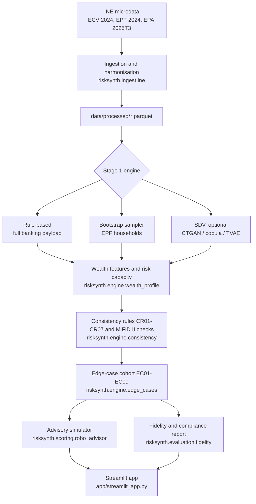

# RiskSynth AI

Synthetic client risk profiles for robo-advisory and wealth management, calibrated on Spanish public microdata from INE (ECV, EPF and EPA surveys).

Each generated client has household finances, the suitability fields a MiFID II robo-advisor asks for (risk tolerance, risk capacity, horizon, maximum drawdown, liquidity need, ESG preference, investment goal) and, for a controlled share of clients, a tagged stress-test scenario. The data contains no real individuals, so it can be used to build and test suitability engines and portfolio recommenders without touching client data.

This is synthetic data for development and testing. It is not calibrated to any real client book and it is not investment advice. Several behavioural parameters are explicit assumptions; read [Calibration status](#calibration-status) before drawing conclusions from the distributions.

## Contents

- [Output schema](#output-schema)
- [How it works](#how-it-works)
- [Installation](#installation)
- [Usage](#usage)
- [Edge-case scenarios](#edge-case-scenarios)
- [Calibration status](#calibration-status)
- [Deployment](#deployment)
- [Development](#development)
- [Project layout](#project-layout)

## Output schema

| Group | Main columns |
|---|---|
| Demographics (INE) | `edad`, `sexo`, `ccaa` (NUTS2), `nivel_estudios`, `situacion_laboral`, `n_miembros`, `dependent_children` |
| Household finances (EPF) | `net_income_annual_eur`, `household_expenses_annual_eur`, `debt_service_annual_eur`, `main_residence_value_eur`, `household_finance_source` |
| Surplus | `raw_surplus_eur` (signed), `investable_surplus_eur` (floored at 0), `surplus_ratio`, `debt_service_to_income`, `liquid_savings_eur` |
| Suitability | `risk_tolerance_score` (1-10) and `risk_tolerance_category`, `investment_horizon_years` and `investment_horizon_bucket`, `max_acceptable_drawdown_pct`, `liquidity_need_pct`, `esg_preference_level`, `primary_investment_goal` |
| Risk capacity | `risk_capacity_score`, `capacity_caps_applied`, `effective_risk_score` = min(tolerance, capacity), `flag_minimum_investment` |
| Audit | `cr_violations_raw`, `cr_repaired`, `profile_inconsistency_flag` |
| Edge cases | `edge_case_id`, `edge_case_matches`, `edge_case_origin`, `is_edge_case`, `expected_robo_behavior`, `expected_capacity_override`, `edge_case_assertion_pass` |
| Rule-based engine only | accounts, balances, mortgage and personal loans, 12 months of transactions, `prob_default` and `default` |

Risk tolerance categories: 1-3 Conservative, 4-6 Moderate, 7-8 Aggressive, 9-10 Ultra-Aggressive. Horizon buckets: Short under 3 years, Medium 3 to under 7 years, Long 7 years or more.

## How it works



1. **Ingestion** maps INE columns to a common schema: age from year of birth, `-9` missing codes to NaN, population-weighted spending divided by the survey weight, and survey-specific codes mapped to common ones (sex, NUTS2 regions, education, employment).
2. **Stage 1** produces base households. Rows from surveys without household finances get them from a matched EPF household (hot-deck imputation); the source is recorded per row.
3. **Stage 2** derives the suitability profile and risk capacity, then validates and repairs the consistency rules. Every engine shares this stage (`risksynth.engine.stage2.run_stage2`), so all outputs have the same schema.
4. **Stage 3** builds the edge-case cohort (8% of rows by default).

All parameters live in `configs/data_config.yaml` (INE mapping, feature specs, capacity caps, rules, edge cases) and `configs/model_config.yaml` (stage-1 models, statistical targets, evaluation thresholds, simulator parameters). Design decisions and verification results are recorded in [docs/migration-notes.md](docs/migration-notes.md).

## Installation

Requires Python 3.10 or newer.

```bash
git clone https://github.com/aditya-forge/RiskSynth-AI.git
cd RiskSynth-AI
pip install -e ".[app,dev]"
pip install -e ".[sdv]"        # optional: CTGAN / Gaussian copula / TVAE engines
```

The harmonised INE base in `data/processed/` is part of the repository, so you can generate data straight away. Install in editable mode (`-e`): the package reads `configs/` and `data/` from the checkout.

## Usage

### Command line

```bash
risksynth-generate                                   # rule-based engine, interactive prompts
risksynth-profiles --n 20000 --seed 42               # profiles from the INE base, no banking payload
risksynth-profiles --edge-case-share 0.04            # change the edge-case share
risksynth-profiles --no-edge-cases
```

The same tools are available as modules, for example `python -m risksynth.engine.stage2`. Outputs go to `data/synthetic/`; set `RISKSYNTH_OUTPUT_DIR` to redirect the rule-based generator.

### Python

```python
from risksynth.engine.wealth_profile import build_stage1_table
from risksynth.generators.client_generator import ClientGenerator

gen = ClientGenerator(n_samples=10_000, method="bootstrap", seed=42)   # "copula", "ctgan", "vae" need SDV
gen.fit(build_stage1_table())
profiles = gen.generate(edge_case_share=0.08)
gen.save("data/synthetic/clients/run_01", profiles)                    # CSV, model .pkl, metadata.json
```

Every run writes a JSON report covering:

- rule violations before and after repair;
- intentional rule exemptions;
- edge-case shares and assertion results;
- capacity caps;
- the credit-field reconciliation.

### Streamlit app

```bash
streamlit run app/streamlit_app.py      # then open http://localhost:8501
```

| Page | Contents |
|---|---|
| Product Overview | Population figures, risk-tier mix against target, surplus distribution, edge-case cohort, capacity vs stated tolerance |
| Solution Architecture | Pipeline, output schema, consistency rules, risk-capacity caps, edge-case catalogue and calibration status |
| Live Generator | Runs the rule-based, bootstrap or SDV engine with a chosen size, risk mix, edge-case share and seed; CSV, Parquet and JSON downloads |
| Advisory Simulator | Model portfolio per client under three rules (stated tolerance only, plus capacity and liquidity, plus a drawdown limit) and the resulting advisor actions |
| Compliance & Fidelity | KS, Wasserstein and Jensen-Shannon tests against INE, correlation heatmaps, rule checks, downloadable HTML report |

The portal uses Streamlit's multipage navigation with a shared header, theme and dataset selector. On an empty deployment, the overview and analysis pages offer a one-click 2,000-client bootstrap demo; use the Live Generator for a configured run.

### Reading CSV outputs

`esg_preference_level` has a category called `None`. By default, `pandas.read_csv` reads the string `None` as a missing value, so those clients silently become NaN. Use the provided reader, or turn off the default NA list:

```python
from risksynth.io import read_profiles, CSV_NA_VALUES

profiles = read_profiles("data/synthetic/clients/run_01/clients_synthetic.csv")
# or: pd.read_csv(path, keep_default_na=False, na_values=CSV_NA_VALUES)
```

Do not pass `na_values=["None"]`: that marks the category itself as missing. Parquet files are not affected.

### Rebuilding the INE base

Only needed to refresh `data/processed/`. Download the microdata in CSV/TAB format from INE ([ECV](https://www.ine.es/dyngs/INEbase/es/operacion.htm?c=Estadistica_C&cid=1254736176807&menu=resultados&idp=1254735976608), [EPF](https://www.ine.es/dyngs/INEbase/es/operacion.htm?c=Estadistica_C&cid=1254736176806&menu=resultados&idp=1254735976608), [EPA](https://www.ine.es/dyngs/INEbase/es/operacion.htm?c=Estadistica_C&cid=1254736176918&menu=resultados&idp=1254735976596)), place it as configured in `ine_source_mapping.raw_layout`, then run:

```
data/raw/
  datos_2024/          ECV_Tp_2024/CSV, ECV_Th_2024/CSV, ECV_Tr_2024/CSV, ECV_Td_2024/CSV
  datos_2024_epf/      EPFhogar/CSV
  datos_3t25/CSV/      EPA_2025T3.tab
```

```bash
risksynth-ingest --source raw
```

The committed base was built without the ECV household files, so household disposable income (`renta_disponible`, INE variable HY020) and ECV regions are empty. Adding `ECV_Th` and `ECV_Td` fills them; the join is already implemented and tested.

## Edge-case scenarios

Edge cases are tagged two ways:

- `edge_case_matches` lists every scenario a row satisfies.
- `edge_case_id` marks a fixed-size test cohort: `target_share x N` rows per scenario, 8% in total.

Each quota is filled with natural matches first; any shortfall is created by changing as few fields as possible on other rows. Exclude rows with `edge_case_origin == "injected"` from fidelity tests.

| ID | Scenario | Share | Expected robo-advisor behaviour |
|---|---|---|---|
| EC01 | High income, low liquidity | 1.00% | Build an emergency fund first; effective risk at most 6 |
| EC02 | Young, high risk, low capital, long horizon | 1.00% | Aggressive allocation through small regular contributions |
| EC03 | Near retirement, seeking growth | 1.00% | Sequence-of-returns warning; effective risk at most 7 |
| EC04 | Spending exceeds income | 1.00% | No new contributions; effective risk at most 5 |
| EC05 | Heavy debt service, high risk appetite | 1.00% | Reduce risk; effective risk at most 5 |
| EC06 | Retiree needing income and liquidity | 0.75% | Cash and short-duration bonds; effective risk at most 6 |
| EC07 | Short horizon, aggressive | 0.75% | Horizon overrides tolerance; effective risk at most 6 |
| EC08 | Contradictory questionnaire | 0.50% | Re-profile; the only scenario allowed to break CR02 |
| EC09 | Valuable home, no free cash flow | 1.00% | Home equity is not risk capacity; effective risk at most 5 |

On the full INE base every scenario meets its expected behaviour in 100% of rows. EC08 never occurs naturally, because the consistency rules remove that contradiction, so all EC08 rows are injected.

## Calibration status

Values in the configs are tagged:

- `[EMPIRICAL]` values were measured on INE microdata, for example income and surplus quantiles, the 40.9% share of households spending more than they earn, and mortgage debt-to-income ratios.
- `[ASSUMPTION]` values have no Spanish source yet: the 40/35/18/7 risk-tier mix, the ESG mix, goals by age, the coefficients of the tolerance model, liquidity priors, the liquid-savings fallback, robo-advisor product minimums and the simulator portfolios.

Calibrate the `[ASSUMPTION]` values against the Banco de España Encuesta Financiera de las Familias (EFF 2022) before any production use. Until then, do not present distributions built on them as statistics about Spanish households.

Known limitations:

- **Under-reported income.** EPF under-reports income relative to spending, which inflates the share of households with negative surplus. `income_calibration_factor` (default 1.0) is the hook to correct it.
- **Donated household finances.** Rows drawn from ECV and EPA persons receive the finances of a matched EPF household (`household_finance_source = donor_epf`).
- **Uncalibrated liquid savings.** Generator account balances (median around EUR 37k-41k) and the fallback model (median around EUR 4.5k) disagree, and neither is calibrated yet.
- **Inferred EPF codes.** Education code 5 (vocational) and the EPF contract-type codes were inferred from data shares; check them against INE's EPF record layout.

## Deployment

The app runs on Streamlit Community Cloud or in any Docker host. Both use the committed INE base in `data/processed/` (`combined_base.parquet` for the rule-based engine and the fidelity checks, `epf_processed.parquet` for the bootstrap sampler), so no data download is needed. Production settings live in `.streamlit/config.toml`:

- dark theme;
- headless mode, so there is no email prompt and no browser launch on startup;
- usage statistics turned off.

Generated datasets are written to the instance's disk and are lost when it restarts; use the download buttons to keep them.

### Streamlit Community Cloud

1. Sign in at [share.streamlit.io](https://share.streamlit.io) with GitHub and choose **Create app**.
2. Repository `aditya-forge/RiskSynth-AI`, branch `main`, main file path **`app/streamlit_app.py`**. The app lives in `app/`, not at the repository root.
3. Under advanced settings pick Python 3.12, then deploy.

Community Cloud installs `requirements.txt`. The app finds the `risksynth` package in `src/` on its own, so no extra build step is needed. The free tier has about 1 GB of memory; the app already caps in-app rule-based runs at 5,000 rows.

### Docker: Render or Google Cloud Run

The `Dockerfile` builds a production image:

- Python 3.12 slim base;
- runs as a non-root user;
- health check on `/_stcore/health`;
- listens on `$PORT` (8501 by default).

```bash
docker build -t risksynth .
docker run -p 8501:8501 risksynth            # http://localhost:8501
```

**Render.**
1. Create a new Web Service from the repository; Render detects the `Dockerfile`.
2. Set the health check path to `/_stcore/health`.
3. Pick an instance with at least 1 GB of memory.

Render sets `PORT` itself.

**Google Cloud Run.**

```bash
gcloud run deploy risksynth \
  --source . --region europe-west1 \
  --memory 2Gi --port 8080 \
  --timeout 3600 --session-affinity \
  --allow-unauthenticated
```

Cloud Run sets `PORT=8080`. Streamlit keeps a websocket open per browser session:
- `--timeout 3600` keeps sessions alive for up to an hour;
- `--session-affinity` keeps each viewer on the same instance.

### Continuous integration

`.github/workflows/ci.yml` runs on every push and pull request to `main`. On Python 3.11 and 3.12 (Ubuntu) it:
1. checks out the code;
2. installs the package with `pip install -e ".[dev]"`;
3. runs the fast test suite, `pytest tests/ -m "not slow"`.

The suite checks behaviour: ingestion, the profile engine and its rules, the edge-case cohort, generator alignment and console encoding. It does not run a linter or type checker. The slow tests (the CLI subprocess and the Streamlit app) are excluded from CI; run them locally with `pytest`.

To block merges that break the tests, add both `Tests (Python 3.11)` and `Tests (Python 3.12)` as required status checks in the repository's branch protection settings.

## Development

```bash
pytest                       # full suite, about 1 minute
pytest -m "not slow"         # skip the CLI subprocess and Streamlit tests
pytest --cov=risksynth       # with pytest-cov
```

| Test module | Covers |
|---|---|
| `tests/test_data_processing.py` | INE mapping, age from birth year, household joins, missing codes, survey weighting, income imputation, code harmonisation, processed-data invariants |
| `tests/test_wealth_engine.py` | Surplus identity, bucket and score boundaries, target mixes, capacity points and caps, rule validation and repair |
| `tests/test_edge_cases.py` | Cohort size and quotas, scenario predicates and expected behaviour, EC08 exemption, share override, portfolio caps |
| `tests/test_generators_alignment.py` | Mortgage and debt alignment with EPF, balance-derived credit fields, bootstrap sampler, behaviour without SDV, CSV reading, console encoding |
| `tests/test_streamlit_app.py` | Portal header and every page render; generator validation; demo dataset feeds the simulator and audit pages |

SDV is optional. Without it, the SDV methods raise `ImportError` and the related test checks exactly that. CI runs the fast suite on every push and pull request to `main`; see [Continuous integration](#continuous-integration).

## Project layout

```
app/                      Streamlit portal entry point (settings in .streamlit/config.toml)
  portal/                 shared data access, theme, navigation and UI components
  views/                  overview, architecture, generator, simulator and compliance pages
Dockerfile                container image for Render / Cloud Run
configs/                  data_config.yaml, model_config.yaml
data/processed/           harmonised INE base (committed)
data/raw/, data/interim/  INE microdata and local rebuild snapshot (not committed)
data/synthetic/           generated datasets (not committed)
docs/                     design and migration notes
src/risksynth/
  ingest/ine.py           INE ingestion
  engine/                 wealth_profile, consistency, edge_cases, stage2
  generators/             generate_synthetic (rule-based), client_generator (bootstrap / SDV)
  scoring/                robo_advisor
  evaluation/             fidelity (current), statistical_tests (legacy)
  io.py, paths.py
tests/
archive/                  configs, app, notebooks and notes from the original credit-risk project
```

## Data sources and license

Built on INE public microdata: Encuesta de Condiciones de Vida 2024, Encuesta de Presupuestos Familiares 2024 and Encuesta de Población Activa 2025 T3. Use of the derived data is subject to INE's terms of use.

Code released under the MIT License, see [LICENSE](LICENSE).
